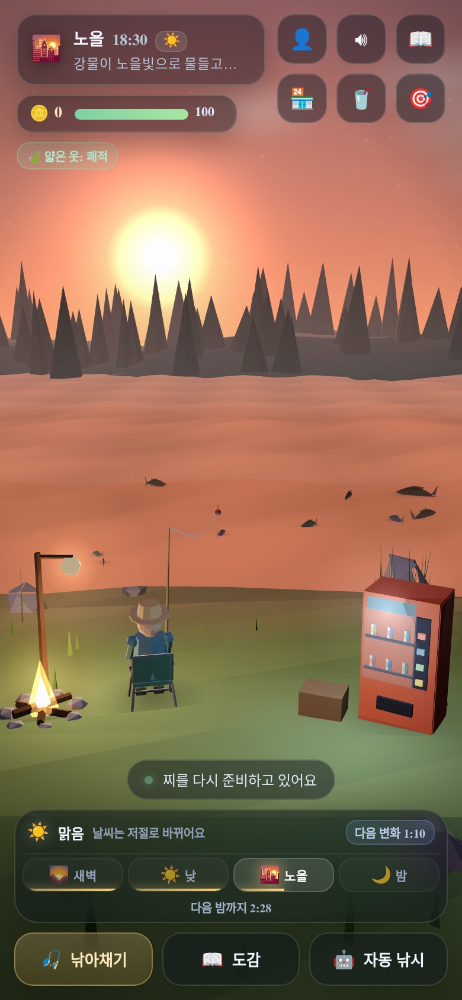
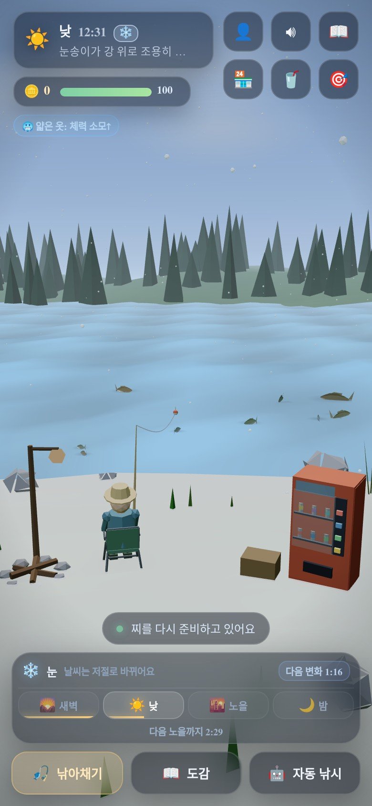
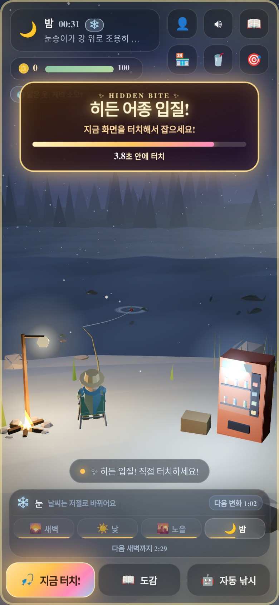
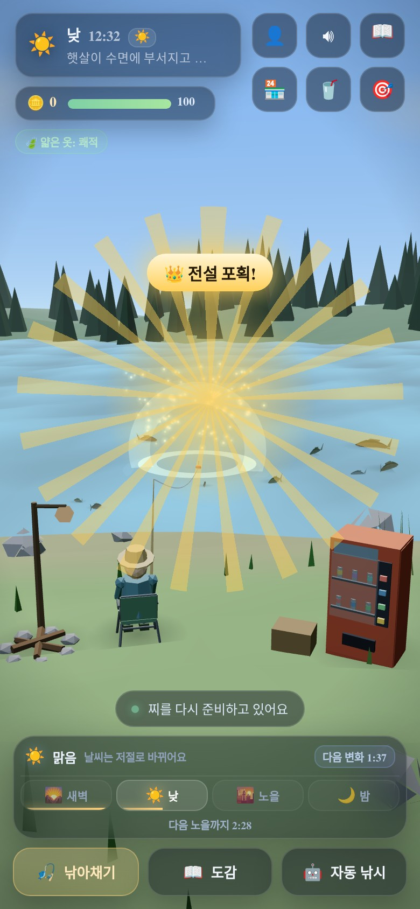
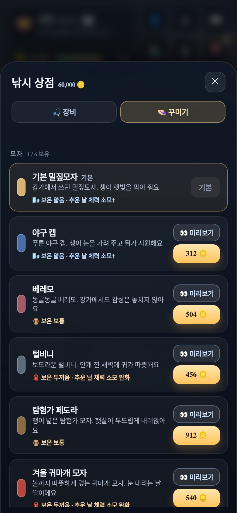
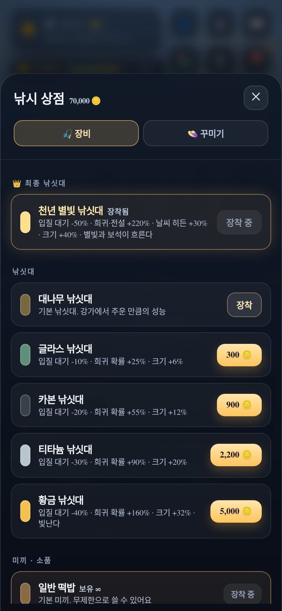
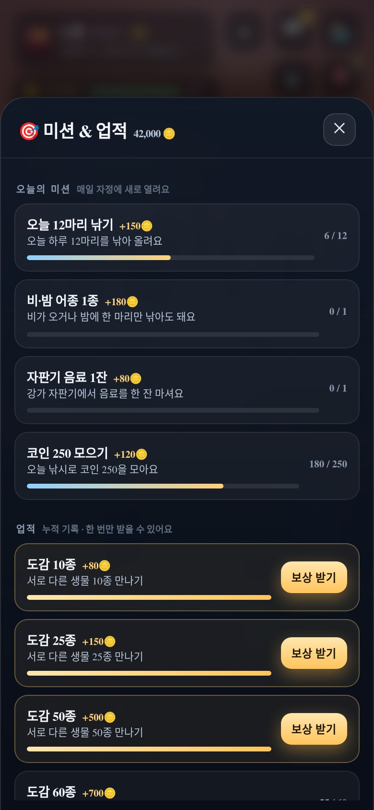
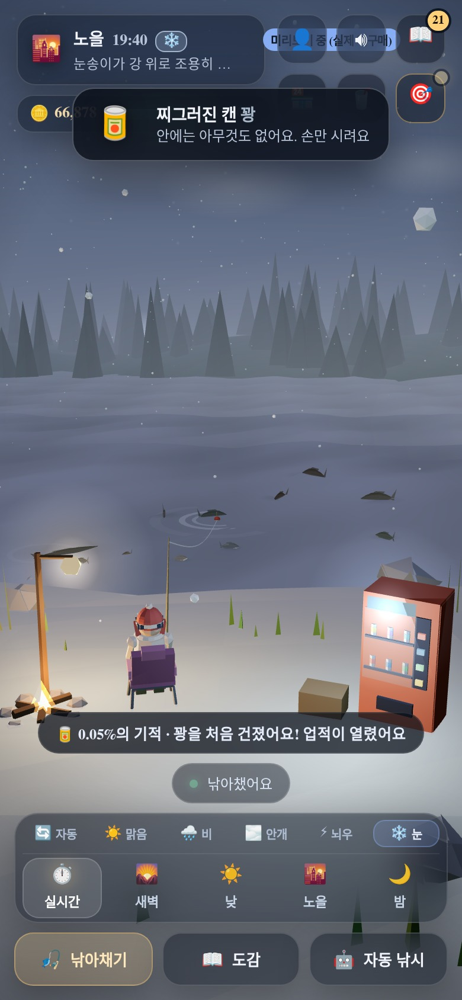
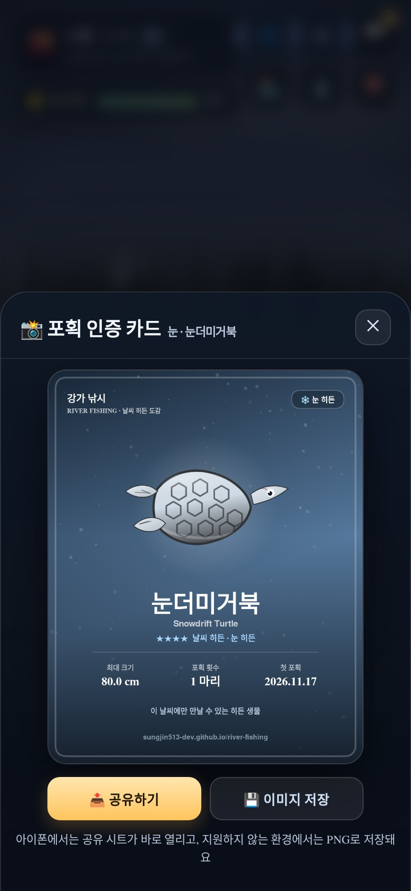
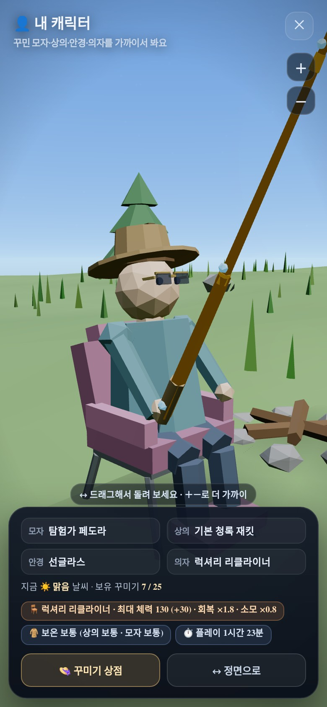

# 🎣 강가 낚시 · River Fishing

로우폴리 3D 강가에서 즐기는 잔잔한 낚시. 5분마다 시간대가 넘어가 20분에 하루가 돌고, 날씨는 저절로 바뀝니다.

**웹 버전 바로 열기 → <https://sungjin513-dev.github.io/river-fishing/>**

아이폰 사파리에서 위 주소를 열면 앱 설치 없이 바로 플레이할 수 있습니다.
공유 시트에서 **홈 화면에 추가**를 누르면 전체 화면 앱처럼 실행됩니다.

| 새벽 05:00 | 낮 12:30 |
| --- | --- |
|  |  |

| 노을 18:00 | 밤 22:00 |
| --- | --- |
|  |  |

| 비 | 안개 |
| --- | --- |
|  |  |

| 뇌우 | ❄️ 눈 |
| --- | --- |
|  |  |

| ✨ 히든 어종 입질 (직접 터치!) | 👑 전설 포획 이펙트 |
| --- | --- |
|  |  |

| 내 캐릭터 · 리클라이너 · 보온 · 플레이타임 | 꾸미기 상점 (보온 배지) |
| --- | --- |
|  |  |

| 👑 최종 낚싯대 (50,000🪙) | 강가 도감 310종 |
| --- | --- |
|  |  |

| 오늘의 미션 · 완료된 보상 일괄 수령 | 🥫 0.05%의 꽝 |
| --- | --- |
|  |  |

| 📸 히든 포획 인증 카드 | 강가 자판기 |
| --- | --- |
|  |  |

---

## 웹 버전 (`index.html`)

`index.html` 한 파일에 모든 것이 들어 있는 자립형 페이지입니다(Three.js만 CDN에서 불러오고 이미지·음원 파일은 0개, WebGL).

### 시간 — 5분에 한 타임, 20분에 하루

- **새벽 🌄 → 낮 ☀️ → 노을 🌇 → 밤 🌙** 네 시간대가 **5분마다** 저절로 넘어가고, 네 번이 지나면 **20분에 하루**가 한 바퀴 돕니다.
- 하늘 그라데이션·해와 달·안개·물빛·랜턴 불빛이 시간에 따라 서서히 바뀝니다. 게임 시계는 HUD에 `05:00`, `12:30`처럼 표시되고, 아래 시간대 바에 **다음 시간대까지 남은 시간**이 흐릅니다.
- **시간대를 직접 고르는 버튼은 없습니다.** 실시간 시계도 쓰지 않고, 게임을 켜면 새벽부터 하루가 시작됩니다.

### 🌦️ 날씨 — 자동 랜덤 전용 (직접 선택 불가)

- **맑음 · 비 · 안개 · 뇌우 · 눈** 5종이 **무조건 자동으로 랜덤 전환**됩니다(45~120초 간격, 시간대에 따라 확률이 조금씩 다름).
  화면에는 **현재 날씨 배지와 다음 변화까지 남은 시간**만 표시되고, 버튼은 하나도 없습니다.
  - **비**: 3D 빗줄기 파티클 520개 + 강물 위 빗방울 잔물결 + Web Audio 빗소리.
  - **안개**: 안개 밀도(near/far)와 색을 강하게 조여 강가 물안개 분위기를 냅니다.
  - **뇌우**: 짙은 먹구름 톤 + 강한 빗줄기 + **불규칙한 번개 섬광**(화면 오버레이 + 하늘·조명 플래시)과 **천둥 소리**.
  - **❄️ 눈**: 3D 눈송이 파티클 720개가 바람에 흩날리고 강둑에 **설경 레이어**가 덮입니다. 눈은 비가 아니므로 꾸민 모자·상의를 입은 채로 낚시합니다.
  - **밤 반딧불이**: 밤에 비·뇌우·눈이 아닐 때 강가 풀밭·갈대 주변을 노랗게 떠다닙니다.
- **날씨 히든 50종** (맑음 10 · 비 10 · 안개 10 · 뇌우 10 · 눈 10): 그 날씨일 때만 나오고, 날씨별 10종이 **각각 1%(날씨당 합 10%)** 확률로 걸립니다.

### ✨ 히든 어종 입질 — 자동 낚시로는 절대 잡히지 않습니다

- **자동 낚시가 켜져 있어도** 날씨 히든이 입질하면 **자동으로 낚이지 않습니다.** 반드시 **직접 터치**해야 챔질됩니다.
- 히든 입질이 오면:
  - 화면 전체 **황금·무지개빛 테두리**가 펄스처럼 점멸하고,
  - 화면 위쪽에 **전용 대형 배너** `✨ 히든 어종 입질! 지금 화면을 터치해서 잡으세요!`와 **남은 시간 프로그레스바(4.6초)** 가 뜨며,
  - 낚아채기 버튼이 무지개 그라데이션으로 커지며 맥동하고, 화면 가운데를 넓게 탭해도 챔질됩니다(전용 터치 레이어).
- **소리도 완전히 다릅니다**: 일반 입질의 낮은 `plop` 대신 **E6 → G#6 → B6로 올라가는 맑은 3음 차임**(반짝임 음 + 짧은 노이즈)이 **약 1.1초마다 반복**되고, 지원 기기에서는 **진동 패턴**도 함께 울립니다. 소리만 들어도 히든인 걸 알 수 있습니다.
- 시간 안에 터치하지 못하면 `✨ 히든을 놓쳤어요…`와 함께 놓칩니다.

### 👆 직접 탭하면 확률 1.2배

- **자동 낚시가 아닌 직접 낚시**(직접 탭해서 캐스팅하고 직접 챔질)로 낚으면 **희귀·전설·날씨 히든 확률이 1.2배**가 됩니다.
  입질 전에 화면을 탭해 이번 캐스팅을 `직접 낚시`로 바꿀 수도 있습니다.
- HUD에 `👆 수동 1.2×` 배지가 표시되고, 수동 모드(자동 OFF)에서는 `👆 수동 모드 · 탭해서 캐스팅` 안내가 뜹니다.
  수동 모드에서는 찌를 직접 던져야 하며, 놓치지 않고 탭할수록 유리합니다.
- 검증: 수동 40,000회 추첨에서 히든 9.9% → 12.0%, 희귀·전설·히든 합계 23.6% → 27.4%로 **약 1.2배**가 확인됩니다.

### 🐟 강가 도감 310종

- 기존 210종(일반 160 + 날씨 히든 50)에 **신규 100종**을 더해 **총 310종**입니다.
  - **민물**: 꽃붕어·줄무늬붕어·여울피라미·옥빛은어·깊은물송어·밤송어·섬강종개·황토다슬기·솔방울우렁·개미조개 등
  - **기수(강어귀)**: 갯물망둑·기수숭어·강어귀농어·갯바람전어·염수새우·뻘게·갯벌가오리·염화가오리 등
  - **심해**: 불빛아귀·어둠갈치·심연홍어·심불오징어·무대장어·별빛새우·은하수가오리 등
  - **거북·가오리·해파리·문어·오징어·게·새우·조개·전설**: 꽃등거북·장식가오리·해파리왕·꽃문어·황혼오징어·광채게·불꽃새우·보랏빛조개·용의비늘·별을삼킨가오리·천년문어·백년붕어·천둥의왕 등
- 시간대(새벽·낮·노을·밤)별 출현 가중치는 **각 시간대 합 100**으로 정규화되고, 310종 모두 디테일 SVG 일러스트(등-배 명암·무늬·눈 하이라이트·종류별 실루엣)가 정상 표시됩니다.
- **도감 헤더에는 채운 개수만** 표시합니다: `채운 도감 N / 310종`. (누적 마릿수 표기는 제거, 개별 카드의 `최대 cm · N마리`는 유지)
- 기존 210종의 ID·도감 기록·`localStorage` 구조는 **100% 그대로** 호환됩니다. 210종 시절 저장 데이터를 그대로 열어도 기록이 유지됩니다.

### 🎆 포획 이펙트 — 등급·종류·날씨별

포획 성공 순간 **3D 씬 + 화면 전체**에 어종에 맞는 이펙트가 터집니다.

| 대상 | 이펙트 |
| --- | --- |
| 일반 · 조금 희귀 | 맑은 물보라 & 물방울 파티클 |
| 희귀 | 에메랄드/블루 반짝임 링 + 빛 파티클 |
| 전설 | 황금빛 폭죽 + 별빛 링 3중 버스트 |
| 날씨 히든 | 날씨 테마 — ☀️ 햇살 섬광 · 🌧️ 빗방울 · 🌫️ 안개 소용돌이 · ⚡ 번개 스파크 · ❄️ 눈꽃 결정 |
| 문어 · 오징어 | 보라/먹물 방울 |
| 꽝 | 작은 잿빛 물보라 |

3D 파티클은 최대 460개 풀에서 물높이에 튕기며 사라지고, 화면에는 방사형 빛살 + `👑 전설 포획!` 같은 라벨이 번쩍입니다.

### 🪑 리클라이너 · 🧣 옷 보온 — 체력 시스템

- **럭셔리 리클라이너 (1,680🪙)**: 구매·장착하면 **최대 체력 100 → 130**, **자연 회복 1.8배(18초 → 10초)**, **체력 소모 20% 경감**.
  원목 접이식 의자는 최대 110·회복 1.3배·소모 0.92배.
  상점 카드에 `🪑 최대 체력 130 (+30) · 회복 ×1.8 · 소모 ×0.8`로, 캐릭터 상세보기와 HUD(체력바·`🪑 리클라이너 · 최대 130` 배지)에도 표시됩니다.
- **옷 두께(보온) × 날씨**: 상의·모자에 `얇음 / 보통 / 두꺼움` 속성이 있습니다.
  - **추운 날(비·뇌우·눈)** 에 얇은 옷 → 체력 소모 **1.5배** (`🥶 얇은 옷: 체력 소모↑`)
  - 추운 날 따뜻한 옷 → 소모 **0.75배**로 추위 상쇄 (`🧣 따뜻한 옷: 추위 완화`)
  - **맑은 날** 두꺼운 패딩·후리스 → 더워서 소모 **1.15배** (`🥵 두꺼운 옷: 더위`), 얇은 옷은 **0.9배**로 쾌적 (`🍃 얇은 옷: 쾌적`)
  - 상의와 모자의 보온을 합산해 판정하고, 상점 카드·캐릭터 상세보기에 `🧣 보온 두꺼움`처럼 표시됩니다.

### 🎣 낚싯대 6종 (최종 50,000🪙)

| 낚싯대 | 가격 | 입질 대기 | 희귀·전설 | 히든 | 크기 |
| --- | ---: | ---: | ---: | ---: | ---: |
| 대나무 | 무료 | 기준 | +0% | +0% | +0% |
| 글라스 | 300🪙 | -10% | +25% | – | +6% |
| 카본 | 900🪙 | -20% | +55% | – | +12% |
| 티타늄 | 2,200🪙 | -30% | +90% | – | +20% |
| 황금 | 5,000🪙 | -40% | +160% | – | +32% |
| **👑 천년 별빛** | **50,000🪙** | **-50%** | **+220%** | **+30%** | **+40%** |

- 상점 `🎣 장비` 탭 맨 위 **`👑 최종 낚싯대`** 섹션에 단독으로 배치되고, 황금 테두리로 강조됩니다.
- 3D 낚싯대도 전용 외형: **황금빛 몸체 + 금테 3개 + 푸른 보석 + 빛나는 끝(발광 오라)** 이 적용되고, 다른 낚싯대로 바꾸면 장식이 사라집니다.
- 구매 즉시 장착되고 `localStorage`에 저장되어 새로고침해도 유지됩니다.

### ⏱️ 플레이타임

- 게임을 시작한 뒤 실제로 플레이한 시간을 **1초 단위로 누적**해 `localStorage`에 저장합니다(15초마다·화면을 벗어날 때 저장).
- `👤 내 캐릭터` 상세보기에 `⏱️ 플레이 1시간 23분` 형식으로 표시됩니다(1시간 미만은 `12분 34초`).
- 예전 저장 데이터에는 값이 없으므로 `0초`부터 시작하고, 자동/수동 낚시 모두에서 자연스럽게 누적됩니다.

### 그 밖에

- **미션 & 업적 🎯**: HUD의 🎯 버튼. **오늘의 미션 4개**(매일 자정 갱신)와 **누적 업적 48개**(도감 310종 완성 포함). 완료된 보상은 `🎁 완료된 보상 일괄 수령`으로 한 번에 받습니다.
- **🥫 0.05%의 꽝**: 모든 날씨에서 0.0005 확률. `누군가의 편지 · 찌그러진 캔 · 낡은 운동화 · 젖은 양말 · 물풀 한 줌` 5종이며 도감 310종 카운트와 완전히 분리됩니다.
  확률 구조는 `꽝 0.05% + 해당 날씨 히든 10%(10종 × 1%) + 일반 어종 89.95%`입니다.
- **낚시 루프**: 캐릭터가 찌를 던지고 기다리다가 입질이 오면 **낚아채기**(화면 탭). 타이밍이 맞으면 길이 보너스가 붙습니다.
- **👤 내 캐릭터 상세보기**: 카메라가 캐릭터 정면으로 근접 줌인. 드래그로 돌려 보고 ＋/－로 더 가까이 볼 수 있습니다.
  아래 패널에 장착 4부위·보유 꾸미기 수·지금 날씨·의자 체력 보강·옷 보온·플레이타임이 표시됩니다.
- **모자 + 안경 동시 착용**: 챙은 눈보다 위로 올라가고 안경·선글라스는 얼굴 앞으로 돌출되어, 어떤 모자와 함께 써도 **선글라스가 가려지지 않습니다**.
- **비·뇌우일 때**: 노란 우비 후드 + 우비 상의로 갈아입고 파라솔이 펼쳐집니다. 그치면 꾸민 차림으로 돌아옵니다.
- **체력바 💚**: 낚시할 때마다 체력이 줄어듭니다(자동 -2, 수동 챔질 -4, 놓치면 -1 × 날씨·의자 배율). 0이 되어도 낚시는 멈추지 않고, '지침' 상태로 입질이 늦어지고 희귀 확률만 낮아집니다.
- **강가 자판기 🥤**: 3D 자판기를 직접 탭하거나 HUD 🥤 버튼으로 엽니다. 생수 15 · 캔커피 40 · 이온음료 70 · 특제 에너지드링크 130🪙.
- **꾸미기 25종**: 모자 6 · 상의 11 · 안경 5 · 의자 3. 구매 즉시 장착, `👀 미리보기`로 사기 전에 임어 볼 수 있습니다.
- **헤엄치는 물고기**: 강가 수면 아래로 물고기 떼가 곡선을 그리며 헤엄칩니다.
- **저장**: 코인·장비·꾸미기·체력·버프·플레이타임·도감(`riverFishingWeb.fishBook.v1`)·경제(`riverFishingWeb.economy.v1`)·미션(`riverFishingWeb.mission.v1`)이 모두 브라우저(`localStorage`)에 저장됩니다.
  기존 210종·200종·100종·56종 시절 저장 데이터의 어종 ID·도감 기록·코인·장비·미션 기록과 그대로 호환되고, 새 필드(플레이타임·보온·의자 성능)는 기본값으로 시작합니다.
- **소리**: 상단 🔊 버튼으로 켜고 끕니다. 비가 오면 빗소리, 뇌우에는 천둥, 히든 입질에는 전용 알람 차임이 울립니다.

## iOS 앱 소스 (`ios/`)

`ios/` 폴더는 같은 세계관을 SwiftUI + SceneKit으로 만든 아이폰 앱 소스입니다.
iOS 16.0+, 외부 라이브러리 0개(Apple 프레임워크만). 자세한 설명은 [ios/README.md](ios/README.md).

> 참고: iOS 쪽 `FishCatalog.swift`는 **웹 56종 시절 데이터**입니다.
> 이후 웹 업데이트(100종 → 200종 → 210종 → **310종·20분 하루·날씨 자동 랜덤·히든 입질 직접 터치·수동 1.2배·포획 이펙트·보온/의자 체력·최종 낚싯대·플레이타임**)는 웹에만 반영했습니다.
