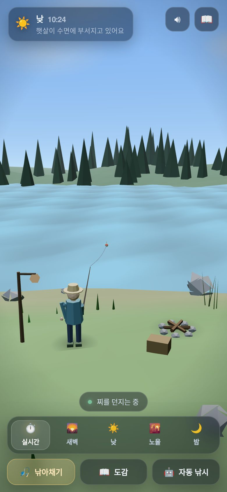
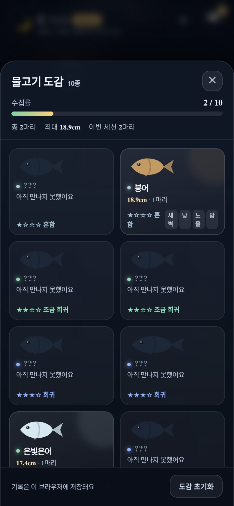

# 🎣 강가 낚시 · River Fishing

로우폴리 3D 강가에서 즐기는 잔잔한 낚시. 시간대마다 빛과 물고기가 바뀝니다.

**웹 버전 바로 열기 → <https://sungjin513-dev.github.io/river-fishing/>**

아이폰 사파리에서 위 주소를 열면 앱 설치 없이 바로 플레이할 수 있습니다.
공유 시트에서 **홈 화면에 추가**를 누르면 전체 화면 앱처럼 실행됩니다.

| 새벽 | 낮 |
| --- | --- |
|  |  |

| 노을 | 밤 |
| --- | --- |
|  |  |

---

## 웹 버전 (`index.html`)

`index.html` 한 파일에 모든 것이 들어 있는 자립형 페이지입니다(외부 라이브러리·CDN 없음, WebGL).

- **시간대**: 실시간 / 새벽 / 낮 / 노을 / 밤 5가지 모드. 실시간 모드는 기기 시각으로 시간대를 정하고,
  하늘 그라데이션·해와 달·안개·물빛·랜턴 불빛이 서서히 바뀝니다.
- **낚시 루프**: 캐릭터가 찌를 던지고 기다리다가 입질이 오면 **낚아채기**(화면 탭).
  타이밍이 맞으면 길이 보너스가 붙습니다.
- **자동 낚시**: 켜 두면 알아서 낚아 도감을 채웁니다.
- **도감**: 물고기 10종. 수집률·마릿수·최대 길이를 확인할 수 있고, 기록은 브라우저에 저장됩니다.
- **소리**: 상단 🔊 버튼으로 켜고 끕니다(기본 꺼짐).

## iOS 앱 소스 (`ios/`)

`ios/` 폴더는 같은 세계관을 SwiftUI + SceneKit으로 만든 아이폰 앱 소스입니다.
iOS 16.0+, 외부 라이브러리 0개(Apple 프레임워크만). 자세한 설명은 [ios/README.md](ios/README.md).

Xcode에서 새 프로젝트(iOS App, SwiftUI)를 만들고 `ios/` 안의 `.swift` 파일들을 프로젝트에 추가하면 실행됩니다.

---

개인 프로젝트입니다. `index.html`은 [GitHub Pages](https://pages.github.com/)로 서비스됩니다.
