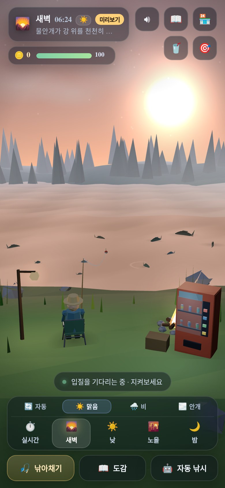
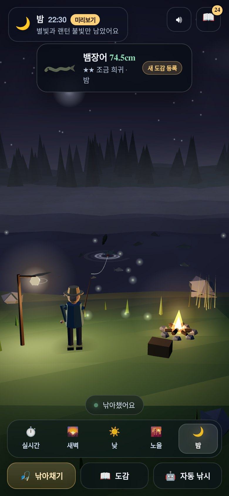
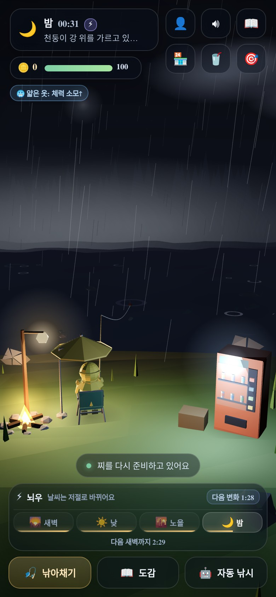
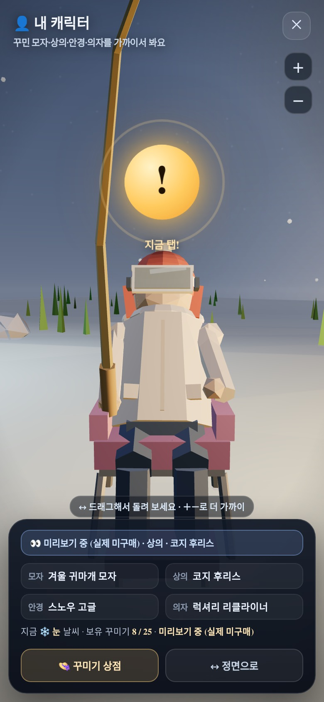
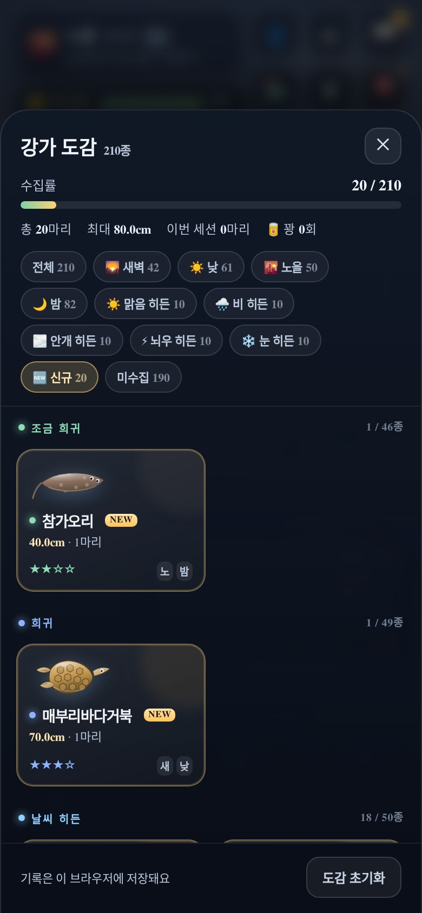
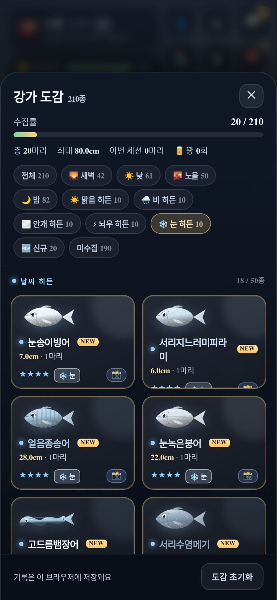
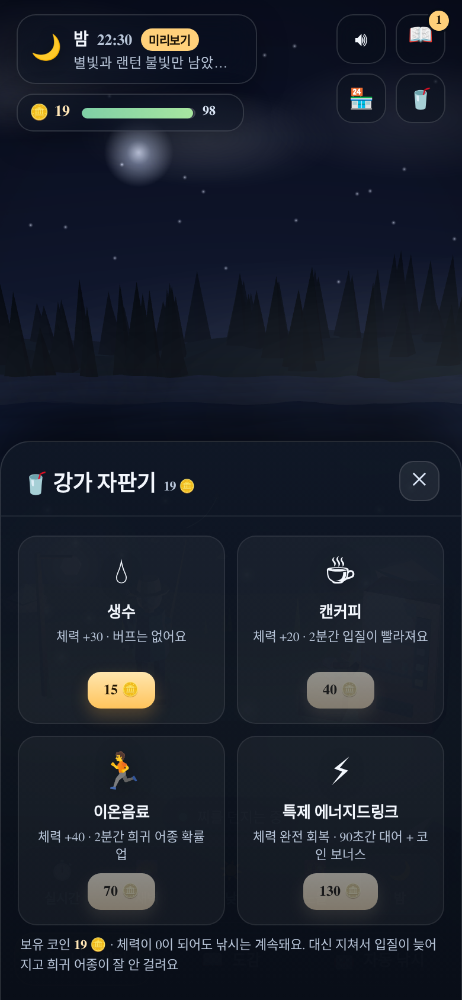

# 🎣 강가 낚시 · River Fishing

로우폴리 3D 강가에서 즐기는 잔잔한 낚시. 시간대와 날씨에 따라 빛과 생물이 바뀝니다.

**웹 버전 바로 열기 → <https://sungjin513-dev.github.io/river-fishing/>**

아이폰 사파리에서 위 주소를 열면 앱 설치 없이 바로 플레이할 수 있습니다.
공유 시트에서 **홈 화면에 추가**를 누르면 전체 화면 앱처럼 실행됩니다.

| 새벽 | 낮 |
| --- | --- |
|  |  |

| 노을 | 밤 |
| --- | --- |
|  |  |

| 비 | 안개 |
| --- | --- |
|  |  |

| 뇌우 | ❄️ 눈 |
| --- | --- |
|  |  |

| 내 캐릭터 상세보기 | 꾸미기 미리보기 |
| --- | --- |
|  |  |

| 오늘의 미션 · 완료된 보상 일괄 수령 | 강가 도감 210종 · 🆕 신규 |
| --- | --- |
|  |  |

| 날씨 히든 도감 (❄️ 눈 히든) | 📸 히든 포획 인증 카드 |
| --- | --- |
|  |  |

| 🥫 0.05%의 꽝 | 강가 자판기 |
| --- | --- |
|  |  |

---

## 웹 버전 (`index.html`)

`index.html` 한 파일에 모든 것이 들어 있는 자립형 페이지입니다(Three.js만 CDN에서 불러오고 이미지·음원 파일은 0개, WebGL).

- **시간대**: 실시간 / 새벽 / 낮 / 노을 / 밤 5가지 모드. 실시간 모드는 기기 시각으로 시간대를 정하고,
  하늘 그라데이션·해와 달·안개·물빛·랜턴 불빛이 서서히 바뀝니다.
- **날씨 ☀️🌧️🌫️⚡❄️ 5종**: 맑음 · 비 · 안개 · 뇌우 · **눈**이 자동으로 순환하고, 하단 `자동 / 맑음 / 비 / 안개 / 뇌우 / 눈` 버튼으로 직접 바꿀 수 있습니다.
  - **비**: 3D 빗줄기 파티클 520개 + 강물 위 빗방울 잔물결(InstancedMesh) + 하늘·조명 톤 다운 + Web Audio 빗소리.
  - **안개**: 안개 밀도(near/far)와 색을 강하게 조여 강가 물안개 분위기를 냅니다.
  - **뇌우**: 비보다 한 단계 더 짙은 먹구름 톤 + 강한 빗줄기 + **불규칙한 번개 섬광**(화면 오버레이 + 하늘·조명 플래시)과
    **Web Audio 천둥 소리**(낮게 깔리는 럼블 + 균열음). 섬광은 두어 번 깜빡이고 천둥은 0.5~1.9초 뒤에 따라옵니다.
  - **❄️ 눈**: 하늘·안개를 차분한 겨울 회백색으로 바꾸고, **3D 눈송이 파티클 720개**가 바람에 흩날리며
    강둑 지형 위에 **하얀 설경 레이어**가 덮입니다(눈이 그치면 서서히 사라짐). 눈은 비가 아니므로
    **꾸민 모자·상의를 입은 채로** 낚시합니다(우비·파라솔 없음).
  - **밤 반딧불이**: 밤에 비·뇌우·눈이 아닐 때 강가 풀밭·갈대 주변을 노랗게 떠다닙니다.
- **미션 & 업적 🎯**: HUD의 🎯 버튼. 보상 받을 것이 있으면 작은 알림 점이 뜹니다.
  - **오늘의 미션 4개** (매일 자정 갱신): 12마리 낚기 / 비·뇌우·눈·밤 어종 1종 / 자판기 음료 1잔 / 코인 250 모으기.
  - **누적 업적 46개** (한 번만 수령): 도감 10·25·50·60·75·100·150·200종, 누적 마리 수, 누적 코인,
    희귀·전설·대어, 날씨 히든(맑음·비·안개·뇌우·**눈**) 5종과 콤플리트, 날씨 히든 12종,
    해파리·오징어·문어, 조개·갑각류, 거북, 꾸미기, 낚싯대·미끼·자판기, 그리고 **0.05%의 기적(꽝 1회)**·**꽝 수집가(꽝 5회)**.
    기존 업적 ID는 그대로라 이전에 달성·수령한 기록이 유지됩니다.
  - **완료된 보상 일괄 수령**: 미션 창 위쪽 `🎁 완료된 보상 일괄 수령` 버튼 하나로 받을 수 있는
    일일 미션·누적 업적 보상을 한 번에 받습니다. 버튼에 `받을 개수`가 표시되고,
    받으면 `미션 N개 · 업적 M개 · 총 K개 완료 보상 +X 🪙 수령!` 알림이 뜹니다.
- **강가 도감 210종**: 기존 200종 + **❄️ 눈 히든 10종**. 물고기·뱀장어·조개·다슬기·게·새우·문어·오징어·거북·가오리·해파리.
  - **날씨 전용 히든 50종** (맑음 10 · 비 10 · 안개 10 · 뇌우 10 · **눈 10**):
    그 날씨일 때만 나오고, 날씨별 10종이 **각각 1%(날씨당 합 10%)** 확률로 걸립니다(낚싯대·미끼 보정 없음).
    도감의 `☀️ 맑음 히든 / 🌧️ 비 히든 / 🌫️ 안개 히든 / ⚡ 뇌우 히든 / ❄️ 눈 히든` 필터와
    카드의 날씨 배지·`❄️ 눈 올 때만 출현` 힌트로 확인할 수 있습니다.
  - **🆕 NEW 배지**: 처음 잡아 도감에 새로 등록된 어종은 결과 팝업에 `NEW` 태그가 붙고,
    도감 카드에도 `NEW` 배지가 7일 동안 남습니다. 도감의 `🆕 신규` 필터로 새로 등록된 어종만 모아 볼 수 있습니다.
  - **어종별 디테일 일러스트**: 등-배 명암 그라데이션 · 지느러미 결 · 꼬리 포인트 컬러 · 눈 하이라이트 · 아가미선에
    종류별 패턴(줄무늬·점박이·옆줄·잔점)과 거북 등껍질 육각 무늬, 게 집게발 마디, 문어·오징어 빨판과 촉수,
    해파리 반투명 갓과 촉수를 더했습니다. 미수집 도감 카드는 기존처럼 어두운 실루엣으로 남습니다.
  - **📸 히든 포획 인증 카드**: 날씨 히든을 잡으면 결과 팝업의 `📸 공유` 버튼(도감의 히든 카드에도 `📸` 버튼)으로
    Canvas로 그린 1080×1350 PNG 카드를 만듭니다 — 날씨별 그라데이션 배경, 날씨 히든 배지, 어종 일러스트,
    이름, 최대 크기·포획 횟수·첫 포획 날짜, 게임 주소가 들어갑니다.
    아이폰 Safari에서는 `navigator.share({files})`로 **OS 공유 시트**가 바로 열리고,
    지원하지 않는 브라우저·환경에서는 **PNG 파일 다운로드**로 대신 저장됩니다.
- **🥫 0.05%의 꽝**: 모든 날씨에서 **0.0005(0.05%)** 확률로 어종 대신 꽝이 걸립니다.
  `누군가의 편지(1🪙) · 찌그러진 캔 · 낡은 운동화 · 젖은 양말 · 물풀 한 줌` 5종으로,
  꽝은 **도감 210종 카운트와 완전히 분리**되어 별도로만 기록되고(도감 상단 `🥫 꽝 N회`),
  전용 토스트(`🥫 ... 꽝!`)와 아이콘으로 표시됩니다. 확률 구조는
  `꽝 0.05% + 해당 날씨 히든 10%(10종 × 1%) + 일반 어종 89.95%`입니다.
- **낚시 루프**: 캐릭터가 찌를 던지고 기다리다가 입질이 오면 **낚아채기**(화면 탭).
  타이밍이 맞으면 길이 보너스가 붙습니다.
- **👤 내 캐릭터 상세보기**: 상단 `👤` 버튼을 누르면 카메라가 캐릭터 정면으로 **근접 줌인**합니다.
  `↔ 드래그`로 캐릭터를 돌려 보고 `＋ / －`로 더 가까이 당겨 모자·상의·안경·의자 디테일을 감상할 수 있습니다.
  아래 패널에 현재 장착 4부위·보유 꾸미기 수·지금 날씨가 한눈에 보이고,
  `👒 꾸미기 상점` / `↔ 정면으로` 버튼이 있습니다. 닫으면 원래 강가 낚시 카메라로 돌아옵니다.
- **캐릭터 🪑**: 강둑의 의자에 **앉아서** 낚시합니다(허벅지·무릎·종아리를 굽힌 자세,
  앉은 채로 숨 쉬듯 살짝 흔들림). **모닥불은 캐릭터 왼쪽 강둑**, 자판기는 오른쪽에 있어요.
  - **비·뇌우일 때**: 노란 우비 후드 + 우비 상의 톤으로 갈아입고, 의자 옆에 작은 낚시 파라솔이 펼쳐집니다.
    맑음·안개·눈으로 돌아오면 자동으로 사라지고 **장착해 둔 모자·상의(꾸미기)로 되돌아옵니다**.
  - **일반 입질**: 상체를 가볍게 세우고 팔을 당겨 챔질.
  - **무거운 물고기**(희귀·전설·날씨 히든·큰 거북·큰 어종): 상체를 뒤로 젖히며 낚싯대가 팽팽하게 휘고
    떨리는 힘겨루기 모션으로 확연히 구분됩니다(릴링 동안에도 이어짐).
  - **체력 0('지침')**: 의자에 앉은 채 고개를 꾸벅꾸벅 조는 루프가 재생되고, 체력이 회복되면
    다시 말똥말똥한 기본 앉기 자세로 돌아옵니다.
- **자동 낚시**: 켜 두면 알아서 낚아 도감을 채웁니다.
- **코인 🪙**: 낚을 때마다 등급과 크기(cm)에 비례해 코인을 획득합니다.
  **밸런스**: 포획 코인과 일일 미션·누적 업적 보상을 이전의 약 50% 수준으로 낮춰(최소 1~2🪙 보장)
  꾸미기 가격 인상과 함께 초반~중반 성장 템포를 조였습니다.
- **체력바 💚**: 낚시할 때마다 체력이 조금 줄어듭니다(자동 -2, 수동 챔질 -4, 놓치면 -1).
  체력이 0이 되어도 **낚시는 절대 멈추지 않고** 계속됩니다 — 대신 '지침' 상태가 되어
  입질이 다소 늦어지고 희귀·전설 확률만 낮아집니다. 체력은 아주 천천히 자연 회복됩니다.
- **강가 자판기 🥤**: 강둑에 선 로우폴리 3D 음료 자판기. 3D 자판기를 **직접 탭**하거나 HUD의 🥤 버튼으로 엽니다.
  - 💧 생수(15🪙) · ☕ 캔커피(40🪙) · 🏃 이온음료(70🪙) · ⚡ 특제 에너지드링크(130🪙)
- **낚시 상점 🏪** — `🎣 장비` / `👒 꾸미기` 두 탭:
  - **낚싯대 5종**: 대나무 → 글라스 300 → 카본 900 → 티타늄 2,200 → 황금 5,000🪙 (3D 낚싯대 색·굵기도 실제로 바뀝니다)
  - **미끼 10종**: 일반 떡밥(무료·무제한) · 향긋한 옥수수 · 반짝이 루어 · 조개살 미끼 · 새우 미끼 ·
    새벽이슬 미끼 · 달빛 미끼 · 왕밥 대어 미끼 · 심해 황금 미끼 · 폭풍 미끼.
    각각 입질 속도 / 대어 크기 / 희귀 확률 / 조개·갑각류 / 해파리·오징어·문어 / 새벽·밤 어종 / 비·뇌우 보너스가 다릅니다.
  - **꾸미기 25종** (구매 즉시 장착, 다시 눌러 해제). 기존 유료 아이템은 **가격을 각각 20% 인상**했습니다.
    - **모자 6**: 기본 밀짚모자(무료) · 야구 캡 312 · 베레모 504 · 털비니 456 · 탐험가 페도라 912 · **겨울 귀마개 모자 540**
    - **상의 11**: 기본 청록 재킷(무료) · 주황 아노락 408 · 네이비 후드 552 · 올리브 베스트 624 · 핑크 가디건 816 ·
      **겨울 패딩 980 · 낚시 베스트 풀세트 760 · 하와이안 셔츠 600 · 스트라이프 니트 690 · 레인저 점퍼 850 · 코지 후리스 800**
    - **안경 5**: 없음(무료) · 둥근 안경 264 · 선글라스 456 · 하트 선글라스 768 · **스노우 고글 480**
    - **의자 3**: 기본 캠핑 의자(무료) · 원목 접이식 의자 576 · 럭셔리 리클라이너(쿠션·머리받침) 1,680
    - **👀 미리보기**: 아직 사지 않은 아이템도 `👀 미리보기` 버튼으로 **구매 전에 3D 캐릭터에 임시로 입혀** 볼 수 있습니다.
      미리보기 중에는 `미리보기 중 (실제 미구매)` 표시가 상단과 상점 배너·캐릭터 상세보기에 뜨고,
      `원래대로` / `바로 구매` / `👤 내 캐릭터로 보기`가 함께 나옵니다.
      상점을 닫거나 새로고침하면 미구매 아이템은 원래 장착 상태로 돌아갑니다(미리보기는 저장되지 않음).
    - 3D 캐릭터에 **즉시 반영**되고 `localStorage`에 저장됩니다. 비·뇌우에는 노란 우비가 우선, 그치면 입고 있던 차림으로 복귀.
- **헤엄치는 물고기**: 강가 수면 아래로 물고기 떼 11마리가 곡선을 그리며 헤엄칩니다. 입질이 오면 한 마리가 찌 쪽으로 다가옵니다.
- **저장**: 코인·장비·꾸미기·체력·버프·도감(`riverFishingWeb.fishBook.v1`)·경제(`riverFishingWeb.economy.v1`)·미션(`riverFishingWeb.mission.v1`)은
  모두 이 브라우저(`localStorage`)에 저장되어 새로고침해도 유지됩니다.
  기존 200종 시절(그 이전 100종·56종 시절 포함) 저장 데이터의 어종 ID·도감 기록·코인·장비·미션 기록과 그대로 호환되고,
  꾸미기 필드가 없던 예전 저장소는 기본 차림에서 시작합니다. 210종으로 늘어난 뒤에도 기존 200종 기록은 그대로 남습니다.
- **소리**: 상단 🔊 버튼으로 켜고 끕니다(기본 켜짐 · 인트로 시작 시 활성화). 비가 오면 빗소리, 뇌우에는 천둥 소리가 섞입니다.

## iOS 앱 소스 (`ios/`)

`ios/` 폴더는 같은 세계관을 SwiftUI + SceneKit으로 만든 아이폰 앱 소스입니다.
iOS 16.0+, 외부 라이브러리 0개(Apple 프레임워크만). 자세한 설명은 [ios/README.md](ios/README.md).

> 참고: iOS 쪽 `FishCatalog.swift`는 **웹 56종 시절 데이터**입니다.
> 이후 웹 업데이트(100종 → 200종 → **210종·날씨 5종·히든 50종·꽝·꾸미기 25종·업적 46개·공유 카드**)는 웹에만 반영했습니다.
