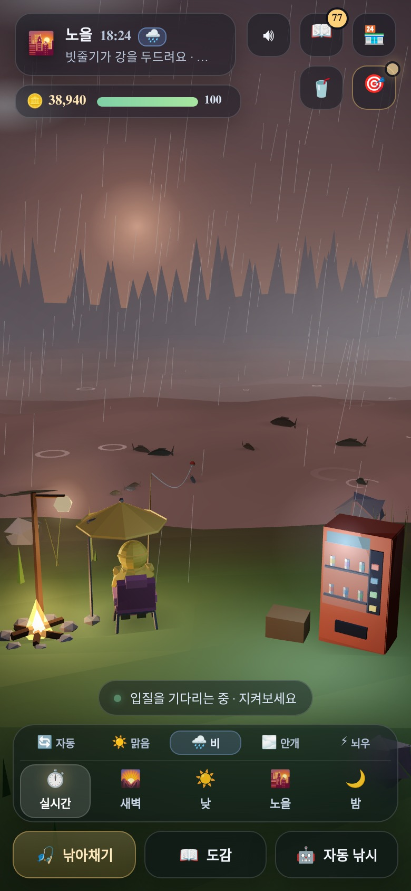
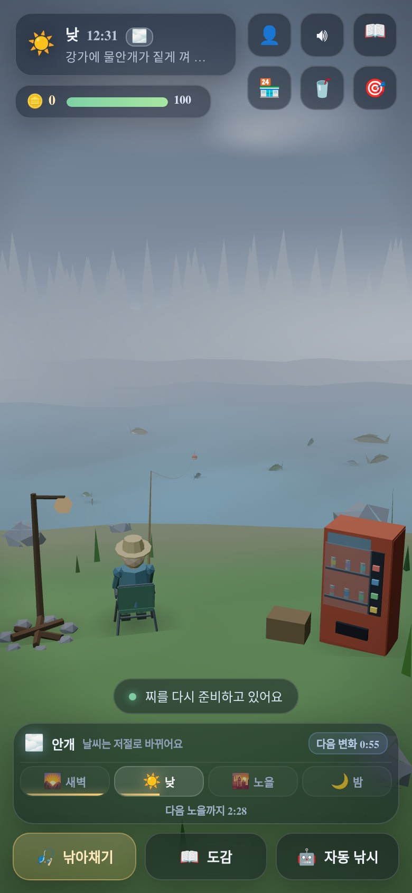
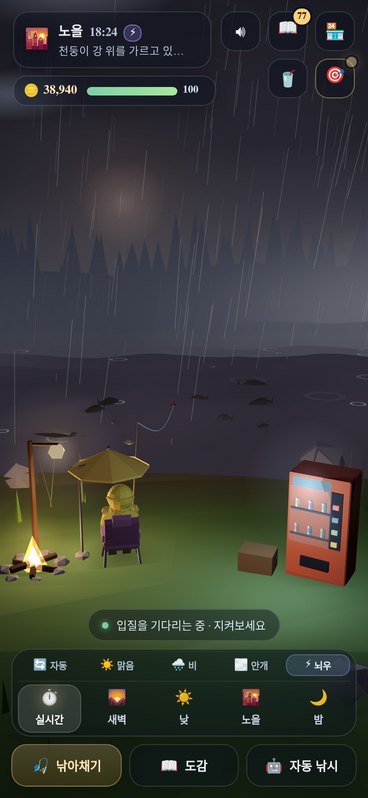
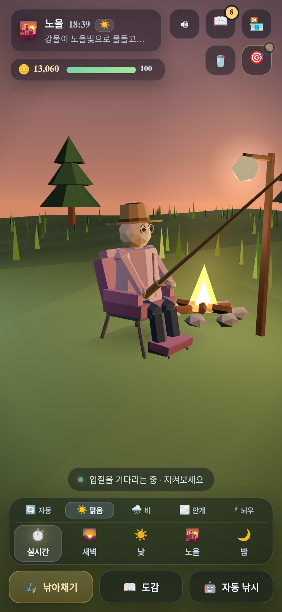

# 🎣 강가 낚시 · River Fishing

로우폴리 3D 강가에서 즐기는 잔잔한 낚시. 시간대와 날씨에 따라 빛과 생물이 바뀝니다.

**웹 버전 바로 열기 → <https://sungjin513-dev.github.io/river-fishing/>**

아이폰 사파리에서 위 주소를 열면 앱 설치 없이 바로 플레이할 수 있습니다.
공유 시트에서 **홈 화면에 추가**를 누르면 전체 화면 앱처럼 실행됩니다.

| 새벽 | 낮 |
| --- | --- |
|  |  |

| 노을 | 밤 |
| --- | --- |
|  |  |

| 비 | 안개 |
| --- | --- |
|  |  |

| 뇌우 | 뇌우 번개 |
| --- | --- |
|  |  |

| 캐릭터 꾸미기 | 꾸미기 상점 |
| --- | --- |
|  |  |

| 오늘의 미션 · 업적 | 강가 도감 200종 |
| --- | --- |
|  |  |

| 날씨 히든 도감 | 강가 자판기 |
| --- | --- |
|  |  |

---

## 웹 버전 (`index.html`)

`index.html` 한 파일에 모든 것이 들어 있는 자립형 페이지입니다(Three.js만 CDN에서 불러오고 이미지·음원 파일은 0개, WebGL).

- **시간대**: 실시간 / 새벽 / 낮 / 노을 / 밤 5가지 모드. 실시간 모드는 기기 시각으로 시간대를 정하고,
  하늘 그라데이션·해와 달·안개·물빛·랜턴 불빛이 서서히 바뀝니다.
- **날씨 ☀️🌧️🌫️⚡ 4종**: 맑음 · 비 · 안개 · 뇌우가 자동으로 순환하고, 하단 `자동 / 맑음 / 비 / 안개 / 뇌우` 버튼으로 직접 바꿀 수 있습니다.
  - **비**: 3D 빗줄기 파티클 520개 + 강물 위 빗방울 잔물결(InstancedMesh) + 하늘·조명 톤 다운 + Web Audio 빗소리.
  - **안개**: 안개 밀도(near/far)와 색을 강하게 조여 강가 물안개 분위기를 냅니다.
  - **뇌우**: 비보다 한 단계 더 짙은 먹구름 톤 + 강한 빗줄기 + **불규칙한 번개 섬광**(화면 오버레이 + 하늘·조명 플래시)과
    **Web Audio 천둥 소리**(낮게 깔리는 럼블 + 균열음). 섬광은 두어 번 깜빡이고 천둥은 0.5~1.9초 뒤에 따라옵니다.
  - **밤 반딧불이**: 밤에 비·뇌우가 아닐 때 강가 풀밭·갈대 주변을 노랗게 떠다닙니다.
- **미션 & 업적 🎯**: HUD의 🎯 버튼. 보상 받을 것이 있으면 작은 알림 점이 뜹니다.
  - **오늘의 미션 4개** (매일 자정 갱신): 12마리 낚기 / 비·뇌우·밤 어종 1종 / 자판기 음료 1잔 / 코인 250 모으기 → 달성 시 `보상 받기`로 코인 지급.
  - **누적 업적 42개** (한 번만 수령): 도감 10·25·50·60·75·100·150·200종, 누적 10·50·100·300·1,000마리,
    누적 코인 500·2,000·10,000·50,000, 희귀 20마리·전설 5·15마리, 80cm·150cm 대어,
    비/맑음/안개/뇌우 히든 5종과 날씨 히든 12종, 해파리·오징어·문어 10·25종, 조개·갑각류 10종, 거북 3종·거북 콤플리트,
    꾸미기 1개·모자 3종·의자 3종·꾸미기 세팅, 낚싯대 업그레이드·티타늄·황금, 미끼 컬렉션, 자판기 단골.
    기존 업적 ID는 그대로라 이전에 달성·수령한 기록이 유지됩니다.
- **강가 도감 200종**: 물고기 100 · 뱀장어류 12 · 조개 14 · 다슬기·우렁 7 · 게 11 · 새우 6 · 문어 9 · 오징어 13 · 거북 10 · 가오리 8 · 해파리 10.
  - **날씨 전용 히든 40종** (맑음 10 · 비 10 · 안개 10 · 뇌우 10): 그 날씨일 때만 나오고,
    각 날씨의 10종이 **각각 3%(합 30%)** 확률로 걸립니다(낚싯대·미끼 보정 없음).
    도감의 `☀️ 맑음 히든 / 🌧️ 비 히든 / 🌫️ 안개 히든 / ⚡ 뇌우 히든` 필터와
    카드의 `☀️ 맑은 날에만 출현` 힌트·날씨 배지로 확인할 수 있습니다.
  - **바다거북류 10종**: 푸른바다거북 · 장수거북 · 붉은바다거북 · 매부리바다거북 · 올리브각시바다거북 · 자라 · 천년자라 +
    날씨 히든 거북(햇살·안개등껍질·폭풍바다거북). 큰 거북은 모두 **무거운 입질** 모션으로 당겨집니다.
  - 종류별 실루엣 SVG 12가지: 물고기 · 장어 · 다슬기 · 조개 · 게 · 새우 · 문어 · 오징어 · **바다거북** · 해파리 · **가오리**.
- **낚시 루프**: 캐릭터가 찌를 던지고 기다리다가 입질이 오면 **낚아채기**(화면 탭).
  타이밍이 맞으면 길이 보너스가 붙습니다.
- **캐릭터 🪑**: 강둑의 의자에 **앉아서** 낚시합니다(허벅지·무릎·종아리를 굽힌 자세,
  앉은 채로 숨 쉬듯 살짝 흔들림). **모닥불은 캐릭터 왼쪽 강둑**, 자판기는 오른쪽에 있어요.
  - **비·뇌우일 때**: 노란 우비 후드 + 우비 상의 톤으로 갈아입고, 의자 옆에 작은 낚시 파라솔이 펼쳐집니다.
    맑음·안개로 돌아오면 자동으로 사라지고 **장착해 둔 모자·상의(꾸미기)로 되돌아옵니다**.
  - **일반 입질**: 상체를 가볍게 세우고 팔을 당겨 챔질.
  - **무거운 물고기**(희귀·전설·날씨 히든·큰 거북·큰 어종): 상체를 뒤로 젖히며 낚싯대가 팽팽하게 휘고
    떨리는 힘겨루기 모션으로 확연히 구분됩니다(릴링 동안에도 이어짐).
  - **체력 0('지침')**: 의자에 앉은 채 고개를 꾸벅꾸벅 조는 루프가 재생되고, 체력이 회복되면
    다시 말똥말똥한 기본 앉기 자세로 돌아옵니다.
- **자동 낚시**: 켜 두면 알아서 낚아 도감을 채웁니다.
- **코인 🪙**: 낚을 때마다 등급과 크기(cm)에 비례해 코인을 획득합니다.
- **체력바 💚**: 낚시할 때마다 체력이 조금 줄어듭니다(자동 -2, 수동 챔질 -4, 놓치면 -1).
  체력이 0이 되어도 **낚시는 절대 멈추지 않고** 계속됩니다 — 대신 '지침' 상태가 되어
  입질이 다소 늦어지고 희귀·전설 확률만 낮아집니다. 체력은 아주 천천히 자연 회복됩니다.
- **강가 자판기 🥤**: 강둑에 선 로우폴리 3D 음료 자판기. 3D 자판기를 **직접 탭**하거나 HUD의 🥤 버튼으로 엽니다.
  - 💧 생수(15🪙) · ☕ 캔커피(40🪙) · 🏃 이온음료(70🪙) · ⚡ 특제 에너지드링크(130🪙)
- **낚시 상점 🏪** — `🎣 장비` / `👒 꾸미기` 두 탭:
  - **낚싯대 5종**: 대나무 → 글라스 300 → 카본 900 → 티타늄 2,200 → 황금 5,000🪙 (3D 낚싯대 색·굵기도 실제로 바뀝니다)
  - **미끼 10종**: 일반 떡밥(무료·무제한) · 향긋한 옥수수 · 반짝이 루어 · 조개살 미끼 · 새우 미끼 ·
    새벽이슬 미끼 · 달빛 미끼 · 왕밥 대어 미끼 · 심해 황금 미끼 · 폭풍 미끼.
    각각 입질 속도 / 대어 크기 / 희귀 확률 / 조개·갑각류 / 해파리·오징어·문어 / 새벽·밤 어종 / 비·뇌우 보너스가 다릅니다.
  - **꾸미기 17종** (구매 즉시 장착, 다시 눌러 해제):
    - **모자 5**: 기본 밀짚모자(무료) · 야구 캡 260 · 베레모 420 · 털비니 380 · 탐험가 페도라 760
    - **상의 5**: 기본 청록 재킷(무료) · 주황 아노락 340 · 네이비 후드 460 · 올리브 베스트 520 · 핑크 가디건 680
    - **안경 4**: 없음(무료) · 둥근 안경 220 · 선글라스 380 · 하트 선글라스 640
    - **의자 3**: 기본 캠핑 의자(무료) · 원목 접이식 의자 480 · 럭셔리 리클라이너(쿠션·머리받침) 1,400
    - 3D 캐릭터에 **즉시 반영**되고 `localStorage`에 저장됩니다. 비·뇌우에는 노란 우비가 우선, 그치면 입고 있던 차림으로 복귀.
- **헤엄치는 물고기**: 강가 수면 아래로 물고기 떼 11마리가 곡선을 그리며 헤엄칩니다. 입질이 오면 한 마리가 찌 쪽으로 다가옵니다.
- **저장**: 코인·장비·꾸미기·체력·버프·도감(`riverFishingWeb.fishBook.v1`)·경제(`riverFishingWeb.economy.v1`)·미션(`riverFishingWeb.mission.v1`)은
  모두 이 브라우저(`localStorage`)에 저장되어 새로고침해도 유지됩니다.
  기존 100종 시절(그 이전 56종 시절 포함) 저장 데이터의 어종 ID·도감 기록·코인·장비·미션 기록과 그대로 호환되고,
  꾸미기 필드가 없던 예전 저장소는 기본 차림에서 시작합니다.
- **소리**: 상단 🔊 버튼으로 켜고 끕니다(기본 켜짐 · 인트로 시작 시 활성화). 비가 오면 빗소리, 뇌우에는 천둥 소리가 섞입니다.

## iOS 앱 소스 (`ios/`)

`ios/` 폴더는 같은 세계관을 SwiftUI + SceneKit으로 만든 아이폰 앱 소스입니다.
iOS 16.0+, 외부 라이브러리 0개(Apple 프레임워크만). 자세한 설명은 [ios/README.md](ios/README.md).

> 참고: iOS 쪽 `FishCatalog.swift`는 **웹 56종 시절 데이터**입니다.
> 이후 웹 업데이트(100종 → 200종·날씨 4종·히든 40종·꾸미기 상점·업적 42개)는 웹에만 반영했습니다.
